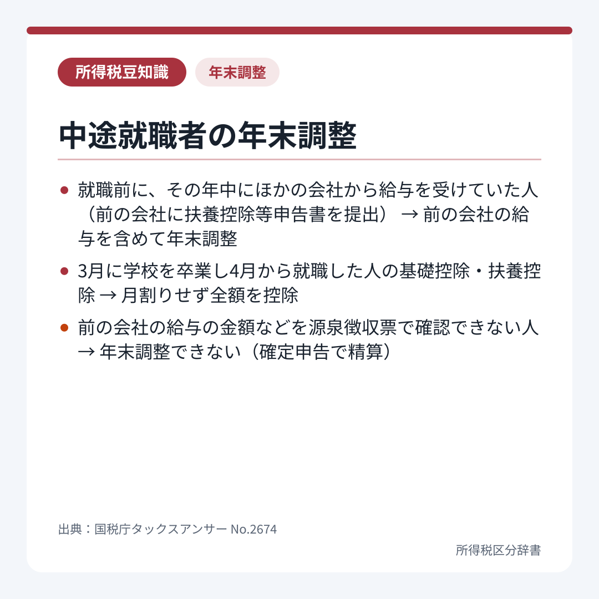

# 2026-11-19 の所得税豆知識



```text
【所得税豆知識】中途就職者の年末調整
（年末調整）

1年を通じて勤務している人のほか、年の中途で就職し、年末まで勤務している人についても年末調整の対象になります。

■ ポイント
・就職前に、その年中にほかの会社から給与を受けていた人（前の会社に扶養控除等申告書を提出） → 前の会社の給与を含めて年末調整
・3月に学校を卒業し4月から就職した人の基礎控除・扶養控除 → 月割りせず全額を控除
・前の会社の給与の金額などを源泉徴収票で確認できない人 → 年末調整できない（確定申告で精算）

出典：国税庁タックスアンサー No.2674
https://www.nta.go.jp/taxes/shiraberu/taxanswer/gensen/2674.htm

詳しくは「所得税区分辞書」で：
https://yzffromazracing-droid.github.io/income-tax-dictionary/#no2674

※一般的な情報です。個別の判断は国税庁の出典や税理士にご確認ください。

#所得税豆知識 #所得税 #年末調整 #税金
```
