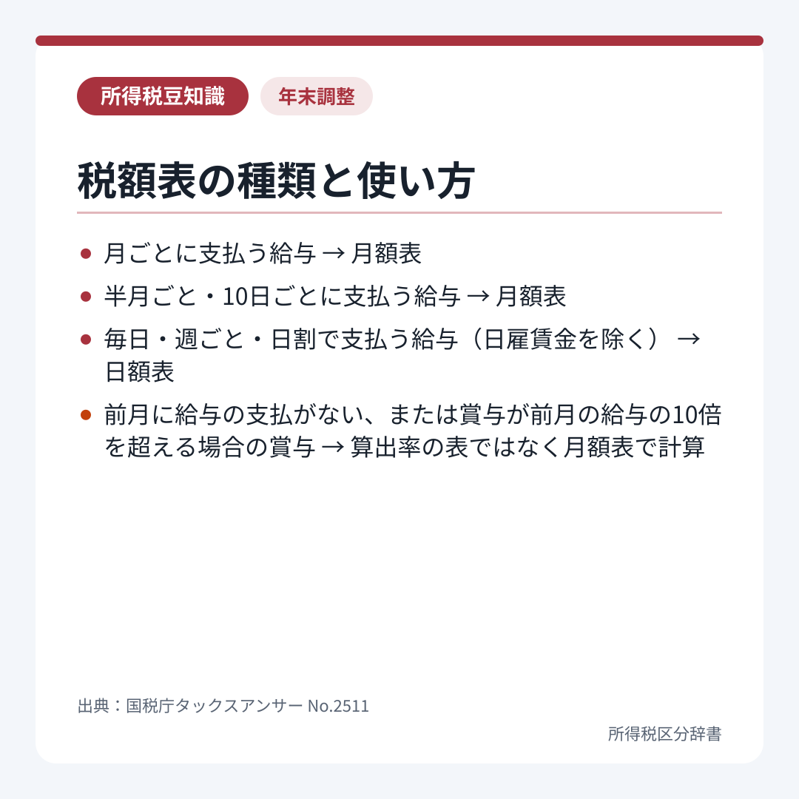

# 2026-11-20 の所得税豆知識



```text
【所得税豆知識】税額表の種類と使い方
（年末調整）

■ ポイント
・月ごとに支払う給与 → 月額表
・半月ごと・10日ごとに支払う給与 → 月額表
・毎日・週ごと・日割で支払う給与（日雇賃金を除く） → 日額表
・前月に給与の支払がない、または賞与が前月の給与の10倍を超える場合の賞与 → 算出率の表ではなく月額表で計算

出典：国税庁タックスアンサー No.2511
https://www.nta.go.jp/taxes/shiraberu/taxanswer/gensen/2511.htm

詳しくは「所得税区分辞書」で：
https://yzffromazracing-droid.github.io/income-tax-dictionary/#no2511

※一般的な情報です。個別の判断は国税庁の出典や税理士にご確認ください。

#所得税豆知識 #所得税 #年末調整 #税金
```
