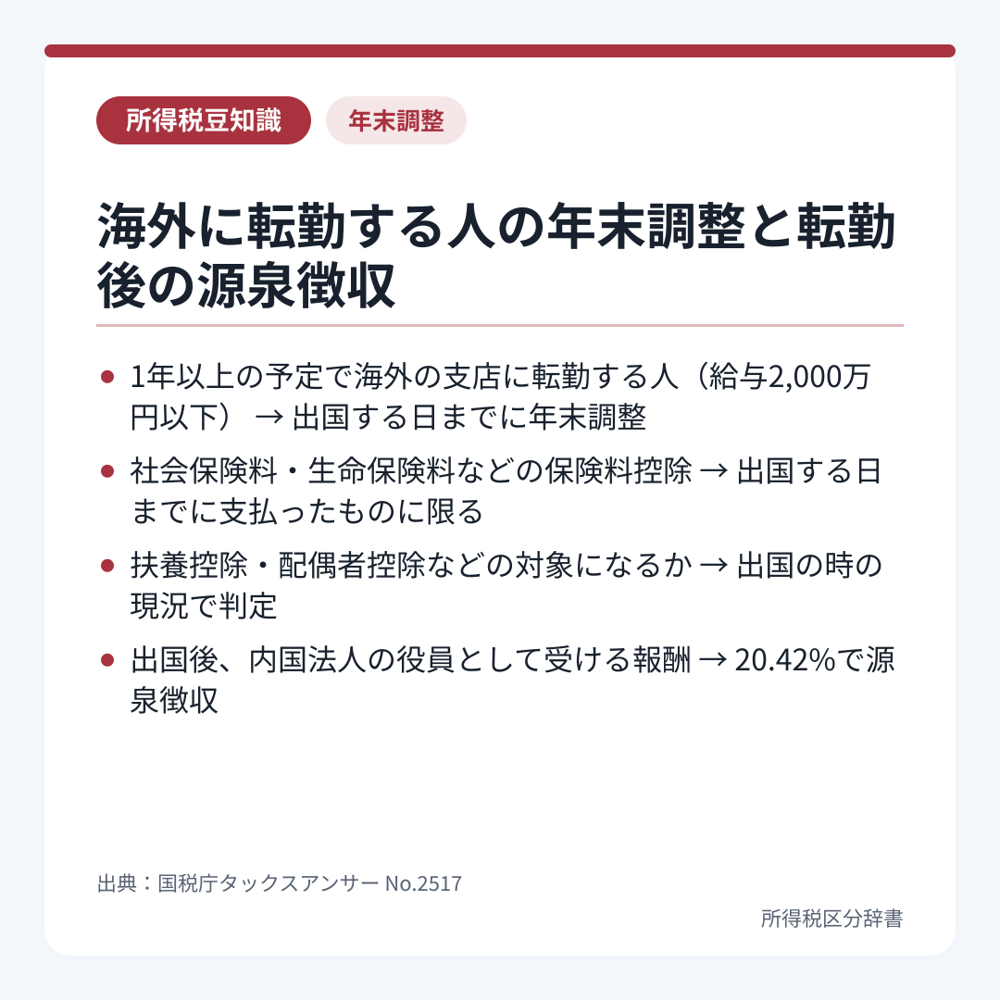

# 2026-11-21 の所得税豆知識



```text
【所得税豆知識】海外に転勤する人の年末調整と転勤後の源泉徴収
（年末調整）

役員や使用人が海外の支店などに1年以上の予定で転勤した場合には、一般的には所得税法でいう非居住者、1年未満であれば居住者になります。

■ ポイント
・1年以上の予定で海外の支店に転勤する人（給与2,000万円以下） → 出国する日までに年末調整
・社会保険料・生命保険料などの保険料控除 → 出国する日までに支払ったものに限る
・扶養控除・配偶者控除などの対象になるか → 出国の時の現況で判定
・出国後、内国法人の役員として受ける報酬 → 20.42%で源泉徴収

出典：国税庁タックスアンサー No.2517
https://www.nta.go.jp/taxes/shiraberu/taxanswer/gensen/2517.htm

詳しくは「所得税区分辞書」で：
https://yzffromazracing-droid.github.io/income-tax-dictionary/#no2517

※一般的な情報です。個別の判断は国税庁の出典や税理士にご確認ください。

#所得税豆知識 #所得税 #年末調整 #税金
```
