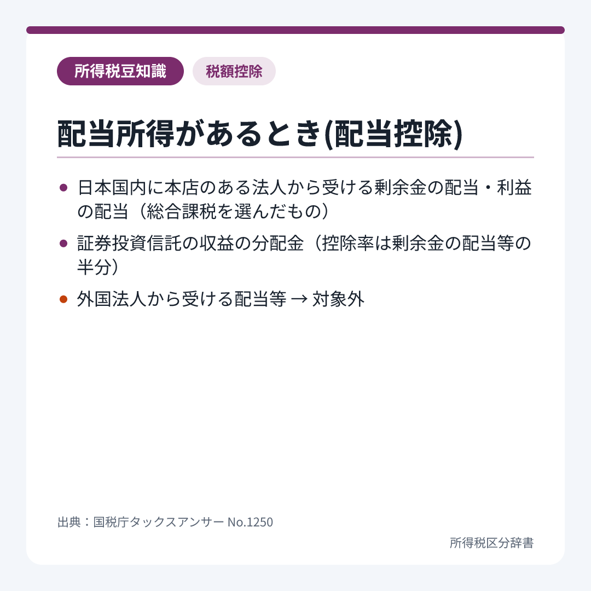

# 2026-11-22 の所得税豆知識



```text
【所得税豆知識】配当所得があるとき(配当控除)
（税額控除）

剰余金の配当などの配当所得があるときには、一定の方法で計算した金額の税額控除を受けることができます。

■ ポイント
・日本国内に本店のある法人から受ける剰余金の配当・利益の配当（総合課税を選んだもの）
・証券投資信託の収益の分配金（控除率は剰余金の配当等の半分）
・外国法人から受ける配当等 → 対象外

出典：国税庁タックスアンサー No.1250
https://www.nta.go.jp/taxes/shiraberu/taxanswer/shotoku/1250.htm

詳しくは「所得税区分辞書」で：
https://yzffromazracing-droid.github.io/income-tax-dictionary/#no1250

※一般的な情報です。個別の判断は国税庁の出典や税理士にご確認ください。

#所得税豆知識 #所得税 #税額控除 #税金
```
