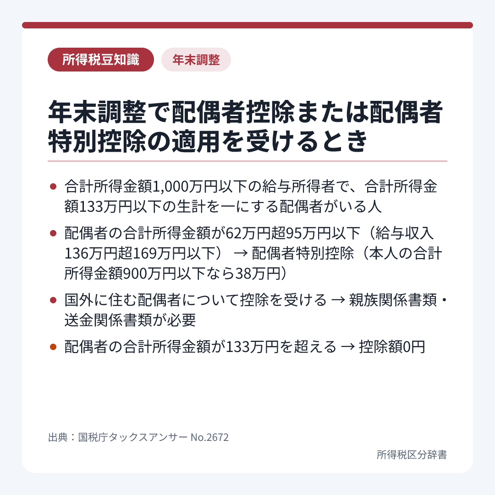

# 2026-11-23 の所得税豆知識



```text
【所得税豆知識】年末調整で配偶者控除または配偶者特別控除の適用を受けるとき
（年末調整）

■ ポイント
・合計所得金額1,000万円以下の給与所得者で、合計所得金額133万円以下の生計を一にする配偶者がいる人
・配偶者の合計所得金額が62万円超95万円以下（給与収入136万円超169万円以下） → 配偶者特別控除（本人の合計所得金額900万円以下なら38万円）
・国外に住む配偶者について控除を受ける → 親族関係書類・送金関係書類が必要
・配偶者の合計所得金額が133万円を超える → 控除額0円

出典：国税庁タックスアンサー No.2672
https://www.nta.go.jp/taxes/shiraberu/taxanswer/gensen/2672.htm

詳しくは「所得税区分辞書」で：
https://yzffromazracing-droid.github.io/income-tax-dictionary/#no2672

※一般的な情報です。個別の判断は国税庁の出典や税理士にご確認ください。

#所得税豆知識 #所得税 #年末調整 #税金
```
