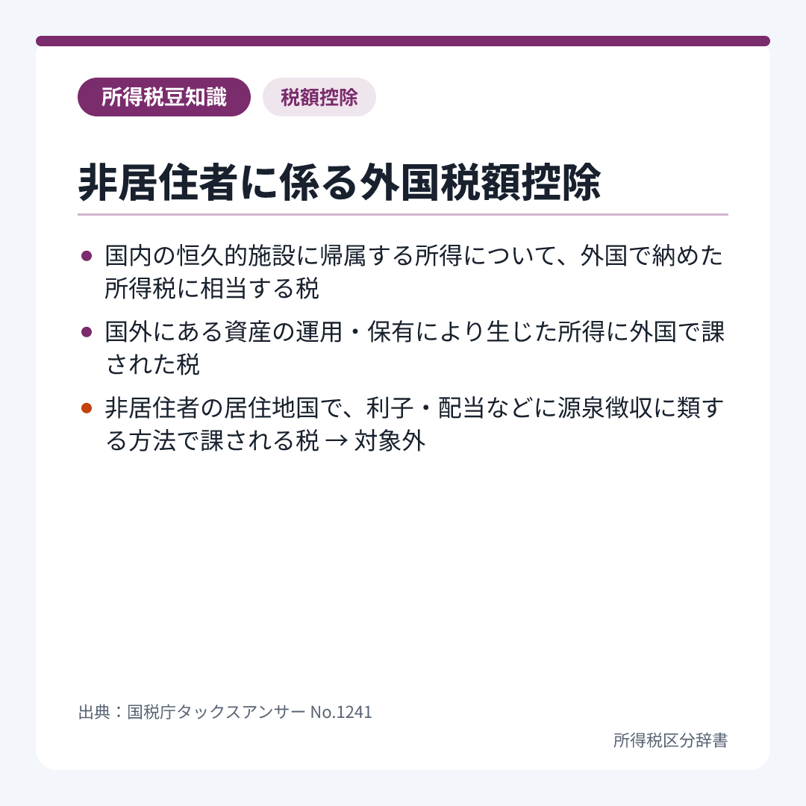

# 2026-11-24 の所得税豆知識



```text
【所得税豆知識】非居住者に係る外国税額控除
（税額控除）

■ ポイント
・国内の恒久的施設に帰属する所得について、外国で納めた所得税に相当する税
・国外にある資産の運用・保有により生じた所得に外国で課された税
・非居住者の居住地国で、利子・配当などに源泉徴収に類する方法で課される税 → 対象外

出典：国税庁タックスアンサー No.1241
https://www.nta.go.jp/taxes/shiraberu/taxanswer/shotoku/1241.htm

詳しくは「所得税区分辞書」で：
https://yzffromazracing-droid.github.io/income-tax-dictionary/#no1241

※一般的な情報です。個別の判断は国税庁の出典や税理士にご確認ください。

#所得税豆知識 #所得税 #税額控除 #税金
```
