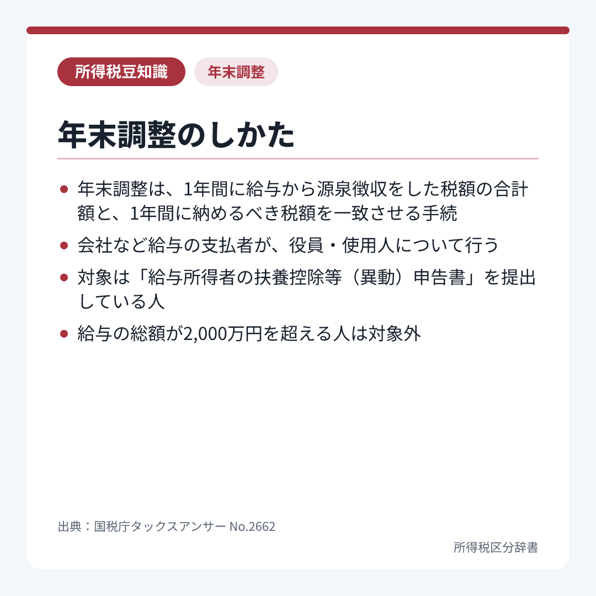

# 2026-11-25 の所得税豆知識



```text
【所得税豆知識】年末調整のしかた
（年末調整）

会社など給与の支払者は、役員または使用人に対して給与を支払う際に所得税および復興特別所得税（令和9年分以後は所得税、防衛特別所得税および復興特別所得税。以下同じです。）の源泉徴収を行っています。

■ ポイント
・年末調整は、1年間に給与から源泉徴収をした税額の合計額と、1年間に納めるべき税額を一致させる手続
・会社など給与の支払者が、役員・使用人について行う
・対象は「給与所得者の扶養控除等（異動）申告書」を提出している人
・給与の総額が2,000万円を超える人は対象外

出典：国税庁タックスアンサー No.2662
https://www.nta.go.jp/taxes/shiraberu/taxanswer/gensen/2662.htm

※一般的な情報です。個別の判断は国税庁の出典や税理士にご確認ください。

#所得税豆知識 #所得税 #年末調整 #税金
```
