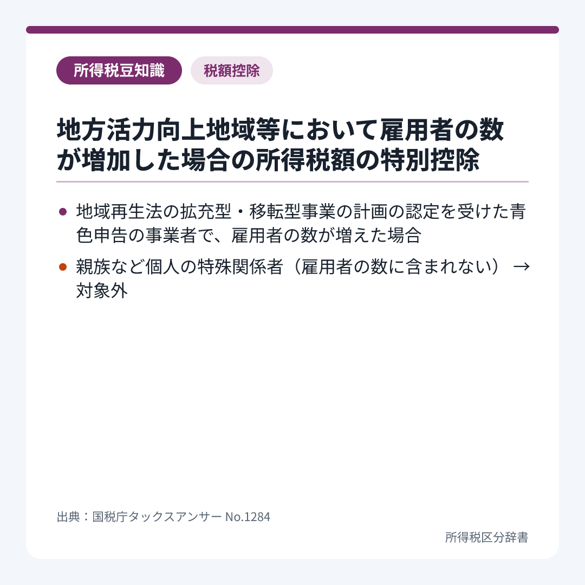

# 2026-11-26 の所得税豆知識



```text
【所得税豆知識】地方活力向上地域等において雇用者の数が増加した場合の所得税額の特別控除
（税額控除）

■ ポイント
・地域再生法の拡充型・移転型事業の計画の認定を受けた青色申告の事業者で、雇用者の数が増えた場合
・親族など個人の特殊関係者（雇用者の数に含まれない） → 対象外

出典：国税庁タックスアンサー No.1284
https://www.nta.go.jp/taxes/shiraberu/taxanswer/shotoku/1284.htm

※一般的な情報です。個別の判断は国税庁の出典や税理士にご確認ください。

#所得税豆知識 #所得税 #税額控除 #税金
```
