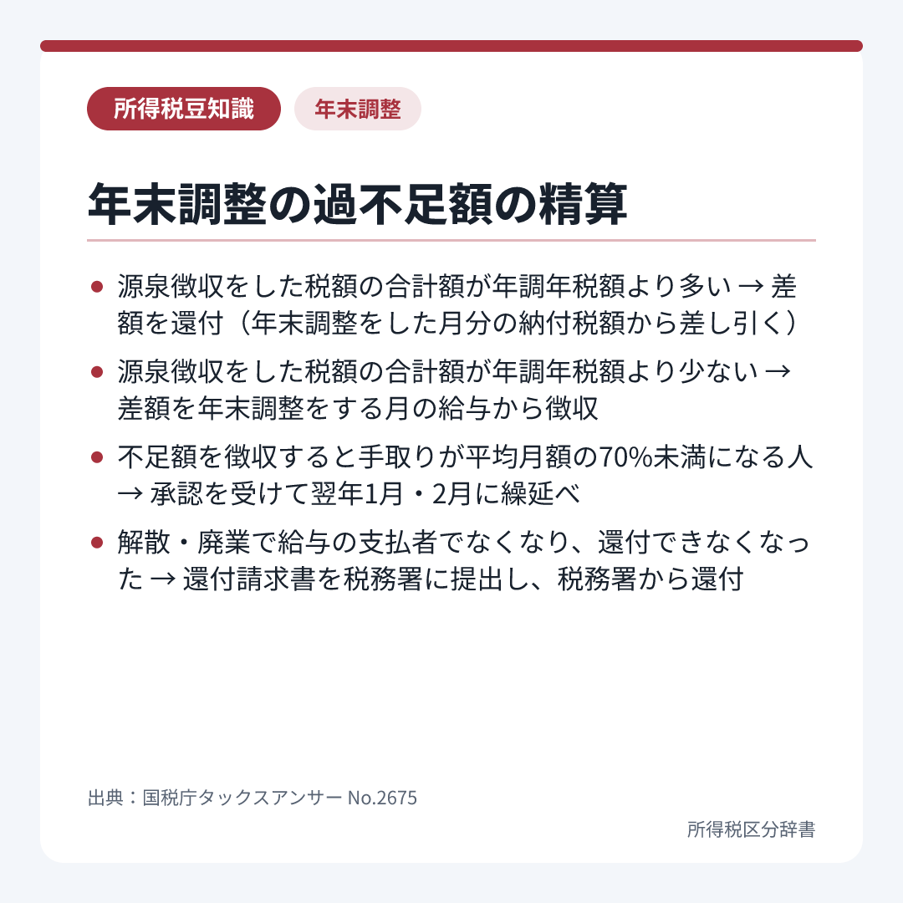

# 2026-11-27 の所得税豆知識



```text
【所得税豆知識】年末調整の過不足額の精算
（年末調整）

■ ポイント
・源泉徴収をした税額の合計額が年調年税額より多い → 差額を還付（年末調整をした月分の納付税額から差し引く）
・源泉徴収をした税額の合計額が年調年税額より少ない → 差額を年末調整をする月の給与から徴収
・不足額を徴収すると手取りが平均月額の70%未満になる人 → 承認を受けて翌年1月・2月に繰延べ
・解散・廃業で給与の支払者でなくなり、還付できなくなった → 還付請求書を税務署に提出し、税務署から還付

出典：国税庁タックスアンサー No.2675
https://www.nta.go.jp/taxes/shiraberu/taxanswer/gensen/2675.htm

※一般的な情報です。個別の判断は国税庁の出典や税理士にご確認ください。

#所得税豆知識 #所得税 #年末調整 #税金
```
